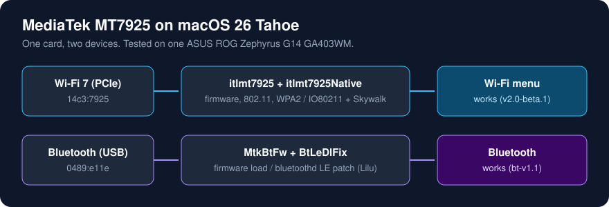

# mt7925-macos

**Wi-Fi and Bluetooth drivers for the MediaTek MT7925 (Wi-Fi 7 card, PCI `14c3:7925` + USB `0489:e11e`) on macOS, x86 Hackintosh.**
The two halves of the card are separate devices, so there are two sets of kexts in one repository. **Wi-Fi:** on macOS 26 Tahoe and
15 Sequoia the card shows up as a real Wi-Fi interface (Wi-Fi menu, network list in System Settings, joining with a password; no
password goes into the kext). **Bluetooth:** the controller works and BLE devices connect, on macOS 26 Tahoe and 15 Sequoia.

[Tiếng Việt](README.vi.md) · **[Install guide](docs/GUIDE.md)** · [Roadmap](docs/ROADMAP.md) · [Releases](https://github.com/thanhnndev/mt7925-macos/releases) · [Bluetooth](docs/BLUETOOTH.md) · [AirDrop / AWDL work](docs/ROADMAP-AWDL.md)

> [!WARNING]
> **Experimental, AI-written, tested on one laptop.** Almost all code and documentation was written by an AI (Claude), directed
> and tested by one person on one **ASUS ROG Zephyrus G14 2025 (GA403WM)**. Nobody has audited it. The kexts run in the kernel, so
> a bug can panic or hang the machine. Back up first and always keep another way online (USB Ethernet, USB tethering).
> No warranty, see [LICENSE](LICENSE).

## Status at a glance (2026-11-25)

| | macOS 26 Tahoe (`25G332`, 26.7.2) | macOS 15 Sequoia (`24H32`, 15.8.1) |
|---|---|---|
| **Native mode** (Wi-Fi menu, join from System Settings) | ✅ **works**, the daily driver on the test machine: WPA2-PSK and open networks. Measured on `25G241`: download 176.6 Mb/s, upload 65.0 Mb/s (`networkQuality`), HE 160 MHz 2×2, DFS channels | ✅ works: 28-36 MB/s on one TCP stream, `networkQuality` 293 Mb/s down / 45 Mb/s up |
| **Legacy mode** (shows up as Ethernet, password injected into the kext) | not tested on Tahoe | ✅ stable, the longest-tested path |
| Where to get it | Wi-Fi: release **v2.0-beta.1** (branch `dev/awdl`). Bluetooth: release **bt-v1.2** (`main`) | branch `sequoia`, releases **v1.1** and **bt-v1.0** |
| **Bluetooth** (`MtkBtFw` + `BtLeDlFix`) | ✅ works on `25G332` with `MtkBtFw` 0.3.3 + `BtLeDlFix` 1.4.0: firmware loads and no advertising error loop (2026-11-27, 0.3.3), BLE mouse verified 2026-11-27 on 0.3.3, no `bluetoothd` fault at boot since 2026-11-23. `MtkBtFw` 0.3.1 delayed the login window by 4 to 9 s; not re-measured on 0.3.3. MT7922 (`0489:e0f6`): experimental, not tested on 0.3.3. Keyboard pairing not recorded. `BtLeDlFix` patches `bluetoothd`: run `tools/btledl-check.py` after every macOS update | ✅ controller works; BLE mouse and classic headphones connect. Keyboard pairing not recorded |
| AirDrop / AWDL / Continuity | 🔧 in progress (off unless `itlmt_awdl=1`). **Not verified as working:** one AirDrop transfer completed in a test (2026-11-11); peers come and go, not usable | ❌ |

The native kext depends on Apple's private Wi-Fi class layouts. The Tahoe build checks them when it starts and refuses to
load on a mismatch (it covers the macOS 26 line; only `25G332` and `25G241` have been run). The Sequoia build is for `24H32` only.
On any other build, check it first (see [GUIDE §7](docs/GUIDE.md#7-other-macos-builds)) before loading it.

## What works

- **Firmware and chip bring-up:** the MediaTek firmware is embedded in the kext, and the MAC address is read from the card.
- **Scanning:** 2.4 GHz channels 1-13 and all of 5 GHz (36-165), including the DFS channels 52-64 and 100-144. The AP table
  holds up to 128 networks, so 2.4 GHz networks are not pushed out of the list in crowded places.
- **Security:** WPA2-PSK with CCMP, WPA/WPA2 mixed networks (CCMP pairwise, TKIP group), and open networks. The 4-way handshake runs in the
  driver, and in native mode macOS supplies the key.
- **Speed:** a link ladder from level 0 to level 6 covers HT, VHT and HE, 160 MHz, 2 spatial streams and Block Ack. If a network
  fails the 4-way handshake at a high level, the driver steps down a level by itself.
- **Native macOS integration:** an `IO80211Controller` and a Skywalk interface. You get the Wi-Fi menu, the System Settings list,
  RSSI and rate, link-quality events (so macOS does not drop the link after 60 s), CoreCapture, and the NSS ioctl.
- **Recovery:** when the link is lost, the driver resets the chip, reloads the firmware and joins again.
- **Bluetooth:** `MtkBtFw` downloads the MT7925 Bluetooth firmware over USB (the Linux `btmtk` procedure), so `bluetoothd` sees a real
  controller; `BtLeDlFix` (a Lilu plugin) lets BLE devices finish connecting. Details and the open items: [docs/BLUETOOTH.md](docs/BLUETOOTH.md).
- **Host tests in CI:** WPA2 crypto vectors, HT/VHT/HE capability parsing, the Block Ack reorder buffer, and a check that the
  generated stubs match the headers.

## What does not work yet

WPA3 / SAE, enterprise (802.1X), 6 GHz, AirDrop / AWDL (work in progress, not usable), and sleep/wake in native mode (not verified).
Bluetooth: keyboard pairing and re-pairing after a restart are not recorded.
Upload is slower than download. A-MSDU receive is off on purpose. Full list and plan: **[docs/ROADMAP.md](docs/ROADMAP.md)**.

## Quick start

1. Pick the release that matches your macOS (table above) from [Releases](https://github.com/thanhnndev/mt7925-macos/releases)
   and unzip `itlmt7925.kext` and `itlmt7925Native.kext`.
2. Copy both to `EFI/OC/Kexts` and add them to `Kernel → Add` in this order: **`itlmt7925.kext` first, then `itlmt7925Native.kext`**.
   Remove any other Wi-Fi kext for this card.
3. Add the boot-args `itlmt_native=1 itlmt_native_if=1 itlmt_native_dp=1 itlmt_fast=6`.
4. Reboot, then join your network from the Wi-Fi menu.
5. Bluetooth (optional): add `MtkBtFw.kext`, `BlueToolFixup.kext` and `BtLeDlFix.kext`, see [GUIDE §13](docs/GUIDE.md#13-bluetooth).

Every step with checks, troubleshooting and how to undo it: **[docs/GUIDE.md](docs/GUIDE.md)**. For Bluetooth add `MtkBtFw.kext`,
`BlueToolFixup.kext` and `BtLeDlFix.kext`: [GUIDE §13](docs/GUIDE.md#13-bluetooth).

## Branches and releases

| Branch | What it is |
|---|---|
| `main` | The released state: the source of `v2.0-beta.1` (Wi-Fi, merged from `dev/awdl` on 2026-11-25) and of `bt-v1.2` (`MtkBtFw` 0.3.3). AWDL code is in the tree but off unless `itlmt_awdl=1` |
| `dev/awdl` | Wi-Fi development; what runs on the test machine: the Tahoe Wi-Fi fixes since `main`, open networks, and the AirDrop / AWDL work (only active with `itlmt_awdl=1`; may panic). Source of `v2.0-beta.1` |
| `fix/bt-waitquiet` | Bluetooth: `MtkBtFw` 0.3.x. Source of `bt-v1.1` (commit `668f400`; the branch tip carries 0.4.0, which was never run). `bt-v1.2` comes from `main` |
| `sequoia` | Frozen macOS 15 line, the source of `v1.0` / `v1.1` |

| Release | macOS | Contents |
|---|---|---|
| `v1.0` | 15 Sequoia | `itlmt7925.kext` (legacy mode only), `ItlWiFi.app`. Copied from `ga403wm-hackintosh` `v1` (Wi-Fi files only) |
| `v1.1` | 15 Sequoia | `itlmt7925.kext` + `itlmt7925Native.kext` (native front end, A-MSDU off), `ItlWiFi.app`. Copied from `ga403wm-hackintosh` `kext-v1.1` |
| `bt-v1.0` | 15 Sequoia | Bluetooth: `MtkBtFw.kext` + `BtLeDlFix.kext`, copied unchanged from `ga403wm-hackintosh` `kext-v1.1`. Not for Tahoe |
| `v2.0-beta.1` | 26 Tahoe | Wi-Fi: `itlmt7925.kext` + `itlmt7925Native.kext`, pre-release. Notes: [.github/release-notes/v2.0-beta.1.md](.github/release-notes/v2.0-beta.1.md) |
| `bt-v1.1` | 26 Tahoe | Bluetooth: `MtkBtFw.kext` 0.3.1 + `BtLeDlFix.kext` 1.4.0. Notes: [.github/release-notes/bt-v1.1.md](.github/release-notes/bt-v1.1.md) |
| `bt-v1.2` | 26 Tahoe | Bluetooth: `MtkBtFw.kext` 0.3.3 (more MT7925 ids, experimental MT7922) + `BtLeDlFix.kext` 1.4.0. Notes: [.github/release-notes/bt-v1.2.md](.github/release-notes/bt-v1.2.md) |

Releases are made by hand; CI only builds and tests.

## Hardware

Any x86 Mac or Hackintosh with an MT7925 card (PCI vendor/device `14c3:7925`) should match. Only the GA403WM has been tested,
so reports from other laptops are welcome: use the bug report template and attach `scripts/native-wifi-test.sh logs`.

The card is two devices: Wi-Fi on PCIe and Bluetooth on USB. That is why Wi-Fi and Bluetooth live in this repository, in
separate kexts. Bluetooth is checked on the GA403WM only (USB `0489:e11e`); other boards may use another USB id, see
[docs/BLUETOOTH.md](docs/BLUETOOTH.md).

## Repository layout

| Path | Contents |
|---|---|
| `kexts/itlmt7925/` | core driver: firmware download, DMA rings, MCU commands, scan/auth/assoc, WPA2, Block Ack, data path, legacy Ethernet front end |
| `kexts/itlmt7925Native/` | native front end: `IO80211Controller`, infrastructure interface, (AWDL interface on `dev/awdl`) |
| `kexts/MtkBtFw/` | Bluetooth: downloads the controller firmware over USB |
| `kexts/BtLeDlFix/` | Bluetooth: Lilu plugin so BLE devices connect through this controller |
| `fw/` | MediaTek Wi-Fi and Bluetooth firmware from linux-firmware (its own license, see `fw/README.md`) |
| `scripts/` | build, install and test helpers (`build.sh`, `native-wifi-test.sh`, `inject-creds.ps1`, ...) |
| `tools/` | ABI research tools (kernel collection readers, vtable/slot checkers, header generators) |
| `abi/native-wifi/` | IO80211 / Skywalk ABI dumps for `24H32` and `25G241` |
| `docs/` | guide, roadmap, design notes, the full hardware test log (`TEST-NATIVE-WIFI.md`) |
| `test/` | host unit tests |

## Related repositories

All of these belong to one project: macOS on one ASUS ROG Zephyrus G14 **GA403WM**.

| Repository | What it is | Latest release |
|---|---|---|
| [ga403wm-hackintosh](https://github.com/thanhnndev/ga403wm-hackintosh) | The hub: OpenCore EFI, ACPI, install notes, state and roadmap, the small helper kexts | [v2 (macOS 26 Tahoe)](https://github.com/thanhnndev/ga403wm-hackintosh/releases/tag/v2) |
| [mt7925-macos](https://github.com/thanhnndev/mt7925-macos) | MediaTek MT7925 Wi-Fi (`itlmt7925`, `itlmt7925Native`) and Bluetooth (`MtkBtFw`, `BtLeDlFix`) | Wi-Fi [v2.0-beta.1](https://github.com/thanhnndev/mt7925-macos/releases/tag/v2.0-beta.1), Bluetooth [bt-v1.2](https://github.com/thanhnndev/mt7925-macos/releases/tag/bt-v1.2) |
| [rog-control-macos](https://github.com/thanhnndev/rog-control-macos) | RogControl app, `AsusWmi`, `AmdCppc`, `rogkeyd`, `StrixDgpuGate` (performance modes, fans, charge limit, GPU mode, Slash, Fn keys) | [rogcontrol-v0.6.0](https://github.com/thanhnndev/rog-control-macos/releases/tag/rogcontrol-v0.6.0) |
| [nvidia-macos-driver](https://github.com/thanhnndev/nvidia-macos-driver) (fork of [nullmoth/nvidia-macos-driver](https://github.com/nullmoth/nvidia-macos-driver)) | The Radeon 890M display and Metal driver for this laptop (`NMXGPU` and its Metal plugin), PolyForm Noncommercial | source tags [ga403wm-890m-out50](https://github.com/thanhnndev/nvidia-macos-driver/releases/tag/ga403wm-890m-out50), [ga403wm-890m-plugin-a6cec1b](https://github.com/thanhnndev/nvidia-macos-driver/releases/tag/ga403wm-890m-plugin-a6cec1b) |
| [ryzen-hypervisor.framework](https://github.com/thanhnndev/ryzen-hypervisor.framework) (fork of [OverlordDev/ryzen-hypervisor.framework](https://github.com/OverlordDev/ryzen-hypervisor.framework)) | AMD-V hypervisor for Docker and the Android emulator on Ryzen, with this machine's fixes | source tag [v0.7.24-ga403wm](https://github.com/thanhnndev/ryzen-hypervisor.framework/releases/tag/v0.7.24-ga403wm) |
| [strix-890m-macos](https://github.com/thanhnndev/strix-890m-macos) | Earlier Radeon 890M research: notes, boot-display kexts, traces. Superseded by the driver above | none |

## History

This driver was developed inside [thanhnndev/ga403wm-hackintosh](https://github.com/thanhnndev/ga403wm-hackintosh) until
2026-10-26. The Wi-Fi part was moved here with its full commit history; the Bluetooth part was added on 2026-11-02 (its earlier
history stays in that repository). Older links and issues live there.

## Credits

| Project | What it gave this one |
|---|---|
| Linux [`mt76`](https://git.kernel.org/pub/scm/linux/kernel/git/torvalds/linux.git/tree/drivers/net/wireless/mediatek/mt76) driver (`mt7925`, `mt76_connac`, `mt792x`), Copyright (C) MediaTek Inc. and the mt76 contributors, BSD-3-Clause-Clear | The MT7925 hardware layer is re-implemented from it: register map, DMA rings, MCU / UNI commands, firmware download, TXD / RXD layouts, the connect path. Parts are line-by-line ports and carry MediaTek's copyright |
| MediaTek firmware from [linux-firmware](https://git.kernel.org/pub/scm/linux/kernel/git/firmware/linux-firmware.git/tree/mediatek/mt7925) | The Wi-Fi and Bluetooth firmware embedded in `itlmt7925.kext` and `MtkBtFw.kext`, under `fw/LICENCE.mediatek` (not the Clear BSD License) |
| Linux `btmtk` / `btusb` (`drivers/bluetooth`) | The Bluetooth firmware download procedure that `MtkBtFw` follows (re-written, not copied) |
| [acidanthera/Lilu](https://github.com/acidanthera/Lilu) (vit9696 and contributors, BSD-3-Clause) | `BtLeDlFix` is a Lilu plugin: built against Lilu's headers and its `plugin_start.cpp`; needs `Lilu.kext` at run time |
| [acidanthera/BrcmPatchRAM](https://github.com/acidanthera/BrcmPatchRAM) (`BlueToolFixup.kext`) | Needed next to the Bluetooth kexts on macOS 12 and later; `BtLeDlFix` uses the same kind of hook. Not included |
| [acidanthera/MacKernelSDK](https://github.com/acidanthera/MacKernelSDK) | Kernel headers and libraries at build time; not redistributed |
| [OpenCore](https://github.com/acidanthera/OpenCorePkg) (acidanthera) | The boot loader that injects the kexts |
| Seemoo Lab's AWDL papers ("One Billion Apples' Secret Sauce", MobiCom 2018; "A Billion Open Interfaces for Eve and Mallory", USENIX Security 2019) and the open AWDL implementations [OWL](https://github.com/seemoo-lab/owl) and [OpenDrop](https://github.com/seemoo-lab/opendrop), and `t4t5/owly` for the frame layout | Protocol facts for the AWDL / AirDrop work (frame formats, election, timing). Read for facts only; no code copied |
| [Claude](https://claude.com/claude-code) (Anthropic) | Wrote most of the code and documentation, directed and tested by thanhnndev |

Not used: no code from `itlwm`, `AirportItlwm` or OpenIntelWireless. Apple-side class layouts come from read-only
inspection of macOS binaries. File-by-file origins and licences: [NOTICE.md](NOTICE.md).

## License

Code: [Clear BSD License](LICENSE). The firmware in `fw/` (Wi-Fi and Bluetooth) is under MediaTek's own license
(`fw/LICENCE.mediatek`). Details: [NOTICE.md](NOTICE.md).
