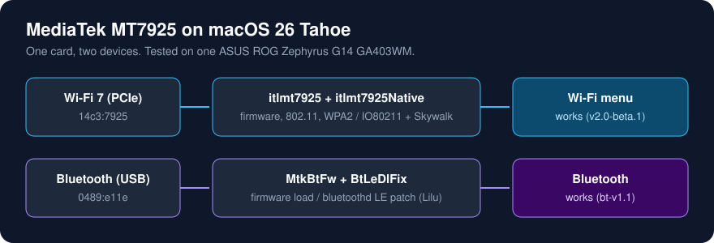

# mt7925-macos

**Driver Wi-Fi và Bluetooth cho MediaTek MT7925 (card Wi-Fi 7, PCI `14c3:7925` + USB `0489:e11e`) trên macOS, Hackintosh x86.**
Hai nửa của card là hai thiết bị riêng nên repo có hai nhóm kext. **Wi-Fi:** trên macOS 26 Tahoe và 15 Sequoia, card hiện thành
giao diện Wi-Fi thật (menu Wi-Fi, danh sách mạng trong System Settings, nhập mật khẩu như máy Mac; không nhét mật khẩu vào
kext). **Bluetooth:** controller chạy và thiết bị BLE kết nối được, trên macOS 26 Tahoe và 15 Sequoia.

[English](README.md) · **[Hướng dẫn cài](docs/GUIDE.vi.md)** · [Roadmap](docs/ROADMAP.md) · [Releases](https://github.com/thanhnndev/mt7925-macos/releases) · [Bluetooth](docs/BLUETOOTH.md) · [AirDrop / AWDL](docs/ROADMAP-AWDL.md)

> [!WARNING]
> **Dự án thử nghiệm, code do AI viết, mới test trên một máy.** Gần như toàn bộ code và tài liệu do AI (Claude) viết, một người
> định hướng và test trên một chiếc **ASUS ROG Zephyrus G14 2025 (GA403WM)**. Chưa ai audit. Kext chạy trong kernel nên lỗi có thể
> gây panic hoặc treo máy. Hãy backup trước và luôn có sẵn đường mạng khác (USB LAN, chia sẻ mạng qua USB). Không bảo hành,
> xem [LICENSE](LICENSE).

## Tình trạng (2026-11-25)

| | macOS 26 Tahoe (`25G332`, 26.7.2) | macOS 15 Sequoia (`24H32`, 15.8.1) |
|---|---|---|
| **Chế độ native** (menu Wi-Fi, kết nối từ System Settings) | ✅ **chạy được**: tải xuống 176.6 Mb/s, tải lên 65.0 Mb/s (`networkQuality`), HE 160 MHz 2×2, kênh DFS | ✅ chạy được: 28-36 MB/s một luồng TCP, `networkQuality` 293 / 45 Mb/s |
| **Chế độ legacy** (hiện là Ethernet, mật khẩu nhét vào kext) | chưa test trên Tahoe | ✅ ổn định, dùng lâu nhất |
| Lấy ở đâu | Wi-Fi: release **v2.0-beta.1** (nhánh `dev/awdl`). Bluetooth: release **bt-v1.1** (nhánh `fix/bt-waitquiet`) | nhánh `sequoia`, release **v1.1** và **bt-v1.0** |
| **Bluetooth** (`MtkBtFw` + `BtLeDlFix`) | ✅ chạy trên `25G332` với `MtkBtFw` 0.3.1 + `BtLeDlFix` 1.4.0: chuột BLE (2026-11-05), hết vòng lặp lỗi advertising (2026-11-08), `bluetoothd` không còn lỗi lúc khởi động (2026-11-23). `MtkBtFw` 0.3.1 làm màn hình đăng nhập chậm thêm 4 đến 9 giây. Chưa ghi nhận ghép bàn phím. `BtLeDlFix` vá `bluetoothd`: chạy `tools/btledl-check.py` sau mỗi lần cập nhật macOS | ✅ controller chạy; chuột BLE và tai nghe classic kết nối được. Chưa ghi nhận ghép bàn phím |
| AirDrop / AWDL / Continuity | 🔧 đang làm ở nhánh `dev/awdl` (mặc định tắt) | ❌ |

Kext native gắn với đúng bản build macOS mà nó được viết cho: bản Tahoe mới kiểm tra trên `25G241`, bản Sequoia trên `24H32`.
Nếu bạn dùng build khác, hãy kiểm tra trước ([GUIDE §7](docs/GUIDE.vi.md#7-bản-build-macos-khác)).

## Đã làm được

- **Firmware và khởi động chip:** firmware MediaTek được nhúng sẵn trong kext, MAC đọc từ card.
- **Quét mạng:** 2.4 GHz kênh 1-13 và toàn bộ 5 GHz (36-165), gồm cả các kênh DFS 52-64 và 100-144. Bảng AP chứa được 128
  mạng, nên ở chỗ đông mạng thì mạng 2.4 GHz không bị đẩy khỏi danh sách.
- **Bảo mật:** WPA2-PSK (CCMP) và mạng WPA/WPA2 hỗn hợp (pairwise CCMP, group TKIP). Bắt tay 4-way chạy trong driver; ở chế độ
  native thì macOS đưa khoá xuống.
- **Tốc độ:** thang mức 0-6 gồm HT/VHT/HE, 160 MHz, 2 luồng, Block Ack. Nếu một mạng không qua được bắt tay ở mức cao, driver
  tự hạ mức.
- **Tích hợp macOS (native):** `IO80211Controller` và giao diện Skywalk. Có menu Wi-Fi, danh sách trong System Settings, RSSI và
  tốc độ, sự kiện chất lượng link (để macOS không ngắt mạng sau 60 giây), CoreCapture, ioctl NSS.
- **Tự phục hồi:** khi mất link, driver reset chip, nạp lại firmware rồi kết nối lại.
- **Bluetooth:** `MtkBtFw` nạp firmware Bluetooth MT7925 qua USB (theo quy trình `btmtk` của Linux) để `bluetoothd` thấy một controller thật;
  `BtLeDlFix` (plugin Lilu) giúp thiết bị BLE kết nối xong. Chi tiết và việc còn mở: [docs/BLUETOOTH.md](docs/BLUETOOTH.md).
- **Test tự động trong CI:** WPA2, phân tích HT/VHT/HE, Block Ack, kiểm tra stub sinh ra khớp với header.

## Chưa có

WPA3 / SAE, enterprise (802.1X), 6 GHz, AirDrop / AWDL (đang làm, chưa dùng được), sleep/wake ở chế độ native (chưa kiểm chứng).
Bluetooth: chưa ghi nhận việc ghép bàn phím và ghép lại sau khi khởi động lại.
Tải lên chậm hơn tải xuống. A-MSDU nhận được cố ý tắt. Chi tiết và kế hoạch xem **[docs/ROADMAP.md](docs/ROADMAP.md)**.

## Cài nhanh

1. Tải release đúng với macOS của bạn (bảng trên) ở [Releases](https://github.com/thanhnndev/mt7925-macos/releases), giải nén
   `itlmt7925.kext` và `itlmt7925Native.kext`.
2. Chép cả hai vào `EFI/OC/Kexts`, thêm vào `Kernel → Add` theo thứ tự **`itlmt7925.kext` trước, `itlmt7925Native.kext` sau**.
   Gỡ các kext Wi-Fi khác đang dùng cho card này.
3. Thêm boot-args `itlmt_native=1 itlmt_native_if=1 itlmt_native_dp=1 itlmt_fast=6`.
4. Khởi động lại, rồi kết nối mạng từ menu Wi-Fi.
5. Bluetooth (tuỳ chọn): thêm `MtkBtFw.kext`, `BlueToolFixup.kext` và `BtLeDlFix.kext`, xem [GUIDE §13](docs/GUIDE.vi.md#13-bluetooth).

Từng bước, cách kiểm tra, sửa lỗi và quay lại: **[docs/GUIDE.vi.md](docs/GUIDE.vi.md)**.

## Nhánh và release

| Nhánh | Nội dung |
|---|---|
| `main` | driver hiện tại: native trên Tahoe và các bản sửa mới nhất của lõi. Release `v2.*` build từ đây |
| `dev/awdl` | đang làm AirDrop / AWDL (phase 3: phát đã chạy, nhận đã tới được peer manager của Apple). Chỉ chạy khi có `itlmt_awdl=1`. Có thể panic |
| `sequoia` | nhánh macOS 15 đã đóng băng, nguồn của `v1.0` / `v1.1` |

| Release | macOS | Gồm |
|---|---|---|
| `v1.0` | 15 Sequoia | `itlmt7925.kext` (chỉ legacy), `ItlWiFi.app`. Chép từ `v1` của `ga403wm-hackintosh` |
| `v1.1` | 15 Sequoia | `itlmt7925.kext` + `itlmt7925Native.kext` (native, A-MSDU tắt), `ItlWiFi.app`. Chép từ `kext-v1.1` |
| `bt-v1.0` | 15 Sequoia | Bluetooth: `MtkBtFw.kext` + `BtLeDlFix.kext`, chép nguyên từ `kext-v1.1` của `ga403wm-hackintosh`. Không dùng cho Tahoe |
| `v2.0-beta.1` | 26 Tahoe | Wi-Fi: `itlmt7925.kext` + `itlmt7925Native.kext`, pre-release (nhánh `dev/awdl`) |
| `bt-v1.1` | 26 Tahoe | Bluetooth: `MtkBtFw.kext` 0.3.1 + `BtLeDlFix.kext` 1.4.0 (nhánh `fix/bt-waitquiet`, commit `668f400`) |

Release được tạo bằng tay; CI chỉ build và chạy test.

## Phần cứng

Mọi máy x86 có card MT7925 (`14c3:7925`) đều có thể nhận driver, nhưng mới có GA403WM được test. Rất mong nhận báo cáo từ
laptop khác: dùng mẫu bug report và đính kèm `scripts/native-wifi-test.sh logs`.

Card gồm hai thiết bị: Wi-Fi qua PCIe và Bluetooth qua USB, nên Wi-Fi và Bluetooth cùng nằm trong repo này, ở các kext riêng.
Bluetooth mới kiểm tra trên GA403WM (USB `0489:e11e`); máy khác có thể dùng USB id khác, xem [docs/BLUETOOTH.md](docs/BLUETOOTH.md).

## Các repo liên quan

Tất cả thuộc cùng một dự án: macOS trên một máy ASUS ROG Zephyrus G14 **GA403WM**.

| Repo | Là gì | Release mới nhất |
|---|---|---|
| [ga403wm-hackintosh](https://github.com/thanhnndev/ga403wm-hackintosh) | Repo chính: EFI OpenCore, ACPI, ghi chú cài đặt, tình trạng và roadmap, các kext phụ | [v2 (macOS 26 Tahoe)](https://github.com/thanhnndev/ga403wm-hackintosh/releases/tag/v2) |
| [mt7925-macos](https://github.com/thanhnndev/mt7925-macos) | Wi-Fi (`itlmt7925`, `itlmt7925Native`) và Bluetooth (`MtkBtFw`, `BtLeDlFix`) cho MediaTek MT7925 | Wi-Fi [v2.0-beta.1](https://github.com/thanhnndev/mt7925-macos/releases/tag/v2.0-beta.1), Bluetooth [bt-v1.1](https://github.com/thanhnndev/mt7925-macos/releases/tag/bt-v1.1) |
| [rog-control-macos](https://github.com/thanhnndev/rog-control-macos) | App RogControl, `AsusWmi`, `AmdCppc`, `rogkeyd`, `StrixDgpuGate` (chế độ hiệu năng, quạt, giới hạn sạc, chế độ GPU, Slash, phím Fn) | [rogcontrol-v0.6.0](https://github.com/thanhnndev/rog-control-macos/releases/tag/rogcontrol-v0.6.0) |
| [nvidia-macos-driver](https://github.com/thanhnndev/nvidia-macos-driver) (fork của [nullmoth/nvidia-macos-driver](https://github.com/nullmoth/nvidia-macos-driver)) | Driver màn hình và Metal cho Radeon 890M của máy này (`NMXGPU` và Metal plugin), giấy phép PolyForm Noncommercial | tag mã nguồn [ga403wm-890m-out50](https://github.com/thanhnndev/nvidia-macos-driver/releases/tag/ga403wm-890m-out50), [ga403wm-890m-plugin-a6cec1b](https://github.com/thanhnndev/nvidia-macos-driver/releases/tag/ga403wm-890m-plugin-a6cec1b) |
| [ryzen-hypervisor.framework](https://github.com/thanhnndev/ryzen-hypervisor.framework) (fork của [OverlordDev/ryzen-hypervisor.framework](https://github.com/OverlordDev/ryzen-hypervisor.framework)) | Hypervisor AMD-V cho Docker và Android emulator trên Ryzen, kèm các bản sửa cho máy này | tag mã nguồn [v0.7.24-ga403wm](https://github.com/thanhnndev/ryzen-hypervisor.framework/releases/tag/v0.7.24-ga403wm) |
| [strix-890m-macos](https://github.com/thanhnndev/strix-890m-macos) | Nghiên cứu Radeon 890M trước đây: ghi chú, kext màn hình lúc boot, trace. Đã được driver ở trên thay thế | chưa có |

## Lịch sử

Driver được phát triển trong [thanhnndev/ga403wm-hackintosh](https://github.com/thanhnndev/ga403wm-hackintosh) tới 2026-10-26,
rồi tách sang đây. Phần Wi-Fi được giữ nguyên lịch sử commit; phần Bluetooth được thêm vào ngày 2026-11-02 (lịch sử cũ của nó vẫn ở repo kia).

## Ghi công

| Dự án | Đóng góp cho repo này |
|---|---|
| Driver Linux [`mt76`](https://git.kernel.org/pub/scm/linux/kernel/git/torvalds/linux.git/tree/drivers/net/wireless/mediatek/mt76) (`mt7925`, `mt76_connac`, `mt792x`), Copyright (C) MediaTek Inc. và các tác giả mt76, BSD-3-Clause-Clear | Lớp phần cứng MT7925 được viết lại theo nó: bản đồ thanh ghi, DMA ring, lệnh MCU / UNI, nạp firmware, layout TXD / RXD, đường kết nối. Một số phần port từng dòng và giữ copyright của MediaTek |
| Firmware MediaTek từ [linux-firmware](https://git.kernel.org/pub/scm/linux/kernel/git/firmware/linux-firmware.git/tree/mediatek) | Firmware Wi-Fi và Bluetooth nhúng trong `itlmt7925.kext` và `MtkBtFw.kext`, theo `fw/LICENCE.mediatek` (không phải Clear BSD) |
| Linux `btmtk` / `btusb` (`drivers/bluetooth`) | Quy trình nạp firmware Bluetooth mà `MtkBtFw` làm theo (viết lại, không chép) |
| [acidanthera/Lilu](https://github.com/acidanthera/Lilu) (vit9696 và cộng sự, BSD-3-Clause) | `BtLeDlFix` là plugin Lilu: build với header và `plugin_start.cpp` của Lilu; cần `Lilu.kext` khi chạy |
| [acidanthera/BrcmPatchRAM](https://github.com/acidanthera/BrcmPatchRAM) (`BlueToolFixup.kext`) | Cần đặt cùng các kext Bluetooth từ macOS 12 trở đi. Không kèm theo |
| [acidanthera/MacKernelSDK](https://github.com/acidanthera/MacKernelSDK) | Header và thư viện kernel lúc build; không phân phối lại |
| [OpenCore](https://github.com/acidanthera/OpenCorePkg) (acidanthera) | Boot loader nạp các kext |
| Các bài báo AWDL của Seemoo Lab (MobiCom 2018, USENIX Security 2019), [OWL](https://github.com/seemoo-lab/owl), [OpenDrop](https://github.com/seemoo-lab/opendrop), `t4t5/owly` | Thông tin giao thức cho phần AWDL / AirDrop. Chỉ đọc lấy thông tin, không chép code |
| [Claude](https://claude.com/claude-code) (Anthropic) | Viết phần lớn code và tài liệu, do thanhnndev chỉ đạo và test |

Không dùng code của `itlwm`, `AirportItlwm` hay OpenIntelWireless. Nguồn gốc từng file: [NOTICE.md](NOTICE.md).

## Giấy phép

Code: [Clear BSD](LICENSE). Lớp phần cứng MT7925 được viết lại dựa theo driver Linux `mt76` (© MediaTek, BSD-3-Clause-Clear).
Firmware trong `fw/` theo giấy phép riêng của MediaTek. Dự án clean-room: không dùng code từ itlwm, AirportItlwm, OWL hay
OpenDrop (GPL). Xem [NOTICE.md](NOTICE.md) và mục [Ghi công](#ghi-công) ở trên.
